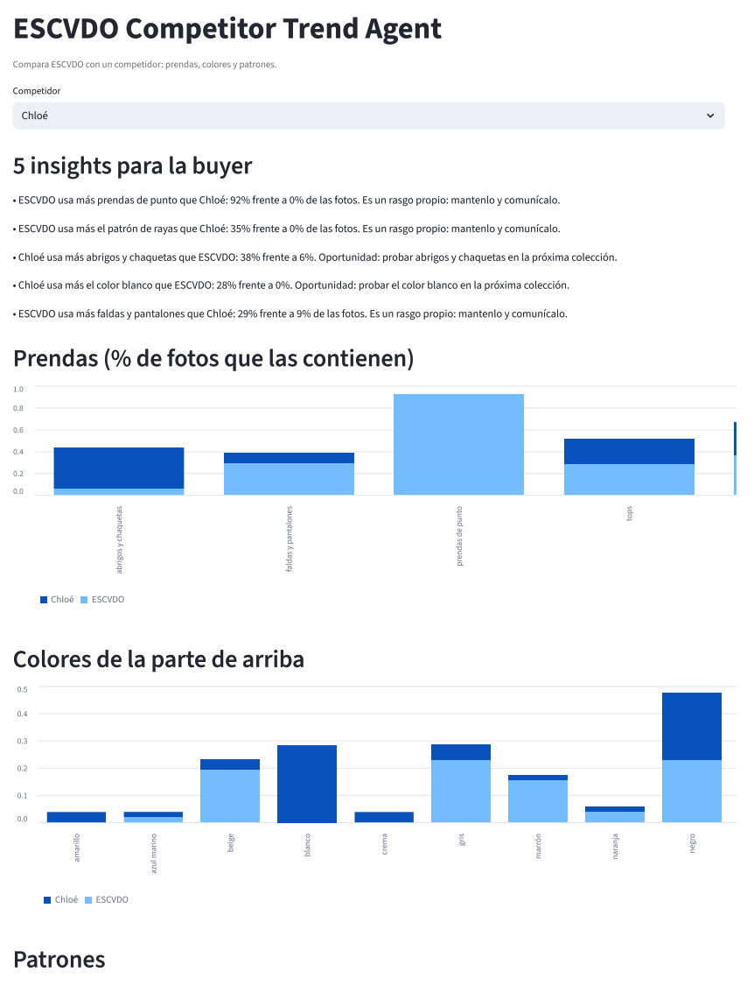

# ESCVDO Competitor Trend Agent

Which colours, garments and patterns does a competitor use that ESCVDO doesn’t? This agent reads competitor photos and answers in plain language, with a suggested action for the buyer



## Why

Buyers compare collections manually. This project makes that comparison measurable: the same attributes, extracted the same way, for every brand.

## What it does

```
photos  ->  type garment  ->  colour  ->  pattern  ->  gaps vs ESCVDO  ->  5 insights  ->  Streamlit app
```

| Step | How | Code |
|---|---|---|
| Collect photos | Chloé: images downloaded directly from the live page. ESCVDO: pages saved as HTML, then parsed and downloaded from the saved file. One folder per brand and collection | `src/parse_saved_page.py`, `src/download_images.py` |
| Garment type | CLIP and FashionCLIP zero-shot (CLIP performed best), then a logistic regression on CLIP embeddings | `src/classify.py` |
| Dominant colour | Background removal + k-means, upper and lower body separately | `src/colors.py` |
| Pattern | CLIP zero-shot, low-confidence predictions reported as "solid / other" | `src/classify.py` |
| Insights | Code computes the biggest gaps between brands, templates write the text | `src/report.py` |
| Interface | Streamlit: pick a competitor, read insights and charts | `app.py` |

Notebooks in `notebooks/`: `01_data_collection`, `02_classification`, `03_insights`.

## Data

- **ESCVDO:** 52 catalogue photos from 5 collections (FW25, PF25, PF26, PS26, SS26).
- **Chloé:** 53 runway looks from SS27 (60 downloaded, 7 non-look items removed).
- Every photo was **hand-labelled, multi-label** (one outfit can contain several garments): tops, bottoms, dresses, knitwear, outerwear.

Photos are not included in this repository (third-party material). The code, my labels and the result tables are.

## Results

**Garment classification** (F1 per garment, 5-fold cross-validation on the labelled photos):

| Garment | Photos | CLIP zero-shot | Trained on CLIP embeddings |
|---|---|---|---|
| Tops | 27 | 0.36 | 0.46 |
| Bottoms | 20 | 0.13 | 0.25 |
| Dresses | 35 | 0.62 | 0.62 |
| Knitwear | 48 | 0.27 | 0.95* |
| Outerwear | 23 | 0.72 | 0.86* |

\*Inflated: all 48 knitwear photos come from ESCVDO and 20 of the 23 outerwear photos from Chloé, so the model can partly learn the brand instead of the garment. Needs more brands for a fair test.

**Colour:** about 5 of 8 manually checked photos matched. **Pattern:** 6 of 8.

Because garment accuracy is still weak, the comparison between ESCVDO and Chloé uses the hand labels. The trained model is meant for new brands.

**Example insights (ESCVDO vs Chloé):**

- ESCVDO uses more knitwear: 92% of photos vs 0%.
- ESCVDO uses more stripes: 35% vs 0%.
- Chloé uses more outerwear: 38% vs 6%.

## What worked and what didn't

- **Single-label evaluation was misleading.** Labels taken from product names ("Lucero Top") don't describe outfits with several garments: many looks were a knitted top plus pants or a skirt. I hand-labelled every photo with multiple garments and used a fairer criterion, so the score went from 42% (strict) to 56% (hit rate). The model did not improve, the measurement did.
- **Zero-shot CLIP over-predicts "dress"** on full-body photos (71% predicted vs 37% in my labels), probably because many photos show matching sets that look like one-piece dresses.
- **Colour:** the first version picked the studio or runway background (78% "beige" for Chloé). Removing the background row by row fixed most of it. Dark skin tones and very pale pastels still fail.
- **A small LLM (Qwen2.5-1.5B-Instruct) hallucinated numbers.** I first asked it to calculate and write the insights, but it invented figures. I switched to code that computes the gaps and templates that write the sentences. An LLM could be added back later only to polish the wording.
- **Scraping was unreliable:** ESCVDO and Ayni returned HTTP 429 (too many requests) and blocked me, so I saved the pages from the browser and parsed them locally.

## Run it

```bash
python -m venv .venv && source .venv/bin/activate
pip install -r requirements.txt            # the app only (pandas, streamlit)
streamlit run app.py
```

The app reads `data/final_table.csv`. To re-run the full pipeline (CLIP, colours, notebooks) install `requirements-pipeline.txt` as well.

## Limitations

- **Small dataset:** about 105 photos from two brands.
- **Different photo types:** ESCVDO photos are catalogue shots and Chloé photos are runway looks, so the comparison is approximate. Most photos show a full outfit with several garments (a top and a skirt, for example), which makes single-garment classification harder.
- **Colour and pattern are automatic and imperfect.** About 14% of ESCVDO photos are tagged "animal print" or "polka dots", but many are probably open crochet texture mistaken for a print. Some have high confidence (0.7 to 0.9), so the confidence threshold alone does not remove them.
- **The garment classifier is confounded with brand:** all knitwear photos come from ESCVDO and most outerwear from Chloé, so the model may partly learn the brand instead of the garment (see the Results table).

## Next steps

- **Add more competitors** (Ayni, Ulla Johnson) to break the brand confound and test on a brand the model has never seen.
- **Crop each photo** into upper and lower body and classify each part separately, to handle full outfits with several garments.
- **Improve colour detection** for pale shades and dark skin tones, and separate open crochet textures from real prints.
- **Let the user upload new photos** and classify them live in the app.
- **Productionize:** tests (`pytest`), a Dockerfile and a FastAPI endpoint.

## Author

Gloria Morales. MSc Business Engineering (Data Analytics), Ghent University.
